# 绿矿智用 · 矿权管理系统

> 省域空间治理数字化平台 —— 矿权管理系统（矿产资源全生命周期一体化监管）
> 依据《矿权管理系统功能设计文档》与 5 张系统截图实现，覆盖文档列出的 **6 大业务域 / 40 个功能点 / 7 个驾驶舱专题**。
> **v2 演示版**：四川口径（21 市州 / 183 区县）+ 图表统一 ECharts + 高德地图 JS API 底图，改造说明见 [docs/07-三项改造说明.md](docs/07-三项改造说明.md)。
> **v2.1 可用性修复**：11 条路由 × 7 档视口的 UI 评审（42 条问题）已全量修复并复测，报告见 [docs/08-UI评审-响应式适配.md](docs/08-UI评审-响应式适配.md)（§8 为修复清单与实测数据）。
> **v2.2 布局二次修复**：底部列表横跨整屏、侧栏面板尺寸与分布按内容适配、ECharts 悬浮提示挂载到 body 不再被容器裁切，说明与实测见 [docs/09-第二轮修复-布局与浮层.md](docs/09-第二轮修复-布局与浮层.md)。
> **v3 界面重构**：冻结组件契约后按模板重写全部界面（设计系统 4 层 CSS / 3627 行 / 8 个媒体查询 / 0 个 `!important`），统一骨架、抽屉、表格与状态；12 条路由 × 4 档视口复测 48 条无溢出，说明见 [docs/13-重构说明-v3.md](docs/13-重构说明-v3.md)、契约见 [docs/11-组件契约-v3.md](docs/11-组件契约-v3.md)、评审见 [docs/12-v3-评审.md](docs/12-v3-评审.md)。
> **v4 视觉对齐**：整体风格回到「严格参照 `系统样式` 截图」——96px 梯形横幅顶栏 + 38px 主标题、40px 导航、面板 4px 圆角 + 40px 斜切标题条、深蓝渐变表头、驾驶舱地图 chrome（专题牌/左上控件/右下分段/右上双按钮）、门户切角卡、作战图梯形统计卡与四色旗帜；逐项对照与偏差见 [docs/14-视觉对齐说明-v4.md](docs/14-视觉对齐说明-v4.md)。
> **v5 unslop 改造**：底部列表改为「收起窄条 + 点击悬浮浮层」、饼图圆心文字真正居中、面板「详情」按业务含义逐面板跳转、删除地图冗余专题按钮、掩膜变浅并按缩放分级展示（≤7 级只看聚合数量、≥8 级铺点）、移除平台分布页并把顶栏压成单行 60px 扁平导航；说明与实测见 [docs/15-界面改造-v5.md](docs/15-界面改造-v5.md)。
> **v6 业务中枢**：新增统一详情纳管模块「业务中枢」（`/hub`，40 个功能点一张表、模块 Tab + 搜索），所有面板「详情」改指向 `/hub/:module/:feature`；15 个流程型功能点在总览与详情页显示环节条（顺序 / 各环节记录数 / 当前集中环节）；6 个业务域侧栏统计全部重做为 3+3 面板（结构占比、TopN、达成率等真实口径）。对照表、侧栏口径与验收见 [docs/16-统一详情纳管与统计重做.md](docs/16-统一详情纳管与统计重做.md)。
> **v7 驾驶舱 Tab 化 + 业务流程图**：矿产地 / 保护与规划 / 矿业权 / 绿色矿山 / 智慧监管 / 数智地勘 六个专题收进数字驾驶舱，用 40px 高的 Tab 条切换（页内切数据、不跳路由、地图不重建），顶部导航收敛为「数字驾驶舱 / 重点任务 | 业务中枢 / 数据仓 / 移动端 / 系统」；业务中枢按 6 个业务域各画一条流程泳道（节点=功能点，带记录数与环节数，点击直接进详情）。说明见 [docs/17-驾驶舱Tab与业务流程图.md](docs/17-驾驶舱Tab与业务流程图.md)。
>
> **v8 antd 组件化 + 四项整改**：①底部矿山列表由横贯长条改为地图内居中箭头胶囊按钮（点击浮出 100 行浮层，双入口收起）；②驾驶舱侧栏字号与间距重做（数值 25px、标签 13px，行高按 2–3 行 84–88px / 4 行以上 42–63px 分档，发丝分隔线）；③饼图圆心文字改用 `series.label` 定位，像素级验证 dx≤0.5px；④九个界面的子模块统一由 antd / @ant-design/x 承载（Table/Tabs/Switch/Select/DatePicker/Drawer/Form/Descriptions/Timeline/Statistic/Pagination），并清掉样式层发光、渐变、彩色阴影等装饰。说明见 [docs/20-v8-antd重构与四项整改.md](docs/20-v8-antd重构与四项整改.md)，回归与评审见 [docs/18-antd重构回归报告.md](docs/18-antd重构回归报告.md)、[docs/19-界面评审-antd重构后.md](docs/19-界面评审-antd重构后.md)。
>
> 仓库：<https://github.com/Mars2077/kuangquan-platform>　｜　在线体验（火山引擎 IGA Pages）：<https://kuangquan-platfo-541ysnljv4-znz3pm72er.preview.iga-pages.com?iga_token=f930545f776be27e34e1d1bfa403e096&iga_time=1795167628>　｜　部署文档：[docs/04-部署说明.md](docs/04-部署说明.md)

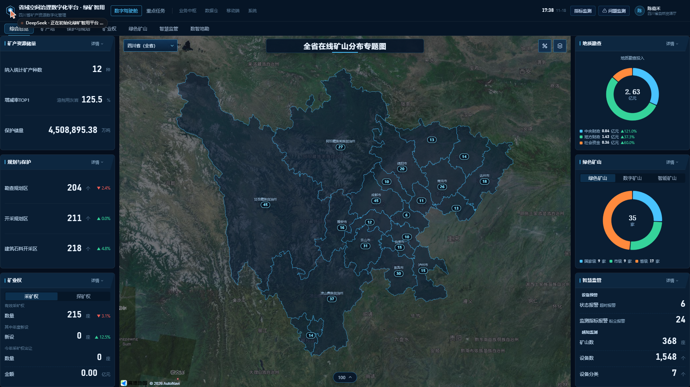

---

## 一、这是什么

一套面向省—市—县三级自然资源主管部门的矿产资源一体化管理平台，包含：

| 层 | 内容 |
| --- | --- |
| 入口层 | 单行顶栏（品牌 + 7 个场景导航 + 指标监测 / 问题监测 / 用户）、统一登录与三级分权；登录后直接进入数字驾驶舱 |
| 一张图层 | 数字驾驶舱：省/市/县三级下钻、专题图层、图斑属性卡、底部可展开的悬浮列表 |
| 业务层 | 矿产地智能管理、保护与规划管理、矿业权管理、绿色矿山管理、矿产资源智慧监管、数智地勘管理 |
| 支撑层 | 绿矿智用数据仓、政务移动端、系统管理（用户/指标监测/操作审计/运行健康） |
| 辅助决策 | 储量核算与三率校验、空间叠置压覆测算、选址合规预检、绿色矿山评分、指标配额、开发利用方案校验、信用评分、超期工单督办 |

演示数据为**按四川省真实行政区划边界与业务口径生成的模拟数据**，非真实矿山台账，仅用于功能演示。

---

## 二、技术栈

| 层 | 选型 | 说明 |
| --- | --- | --- |
| 前端 | React 18.3 + Vite 5 + React Router 6 | HashRouter，按页面懒加载 |
| 样式 | 原生 CSS + 设计令牌（tokens.css） | 不引入 UI 框架，避免样式覆盖；设计规范见 [docs/05-设计规范.md](docs/05-设计规范.md) |
| 动效 | GSAP 3.13 + Motion 12 | 首屏入场、数字滚动、卡片聚光；遵循 `prefers-reduced-motion` |
| 地图 | 自研 SVG 矢量投影 | 真实四川省 11 市 / 102 区县 GeoJSON，无第三方地图 Key 依赖 |
| 图标 | @hugeicons/react（core-free-icons） | 全站统一图标集，不使用近似绘制 |
| 后端 | Node.js 22 + Express 4 | ES Module，零构建直接运行 |
| 数据库 | SQLite（`node:sqlite` 内置模块） | 免安装、免编译；单文件 `server/data/kuangquan.db`，WAL 模式 |
| 鉴权 | JWT + bcryptjs | 三级行政区划数据权限（`region_code` 前缀隔离） |
| 导出 | ExcelJS（服务端 xlsx）+ 前端 CSV | 列表导出与作战图导出 |
| 二维码 | qrcode（服务端生成 DataURL） | 「一矿一档」扫码溯源 |

> 选型理由：政务类单机/内网部署场景下，Node + SQLite 可实现「解压即跑」，无需独立数据库服务；数据规模（百万级行以内）下 SQLite 的性能与运维成本优于 MySQL。

---

## 三、快速开始

### 环境要求

- Node.js **≥ 22**（依赖内置 `node:sqlite`，20 及以下不可用）
- npm ≥ 9
- 端口：`8787`（API + 生产静态托管）、`5173`（开发态前端）

### 方式一：开发态（推荐首次体验）

```bash
# 1. 安装依赖（前后端一起装）
npm run setup

# 2. 初始化演示数据（首次自动执行，也可手动强制重灌）
npm run seed

# 3. 同时启动 API + 前端
npm run dev
```

- 前端：<http://127.0.0.1:5173/>
- API 健康检查：<http://127.0.0.1:8787/api/health>
- 仅启动 API：`npm run dev -- --api`

### 方式二：生产态（构建后单端口运行）

```bash
npm run build     # 构建前端到 web/dist
npm start         # 启动 API，并静态托管 web/dist
```

访问 <http://127.0.0.1:8787/>（SPA 单端口，无需 Nginx）。

### 方式三：纯静态部署（无后端进程，火山引擎 IGA Pages 线上版）

线上地址见本节末尾。该形态把数据与业务逻辑下沉到浏览器：构建时带上真实数据库导出的快照，
运行期由前端内置的接口层接管全部 `/api/*` 请求，因此可以放在任意静态站点/CDN 上（IGA Pages、OSS、Nginx 均可）。

```bash
npm run export:snapshot          # 1. 从 SQLite 导出快照 + 同步功能规格到前端
npm run build:demo               # 2. 以 demo 模式构建（产物 web/dist 即完整站点）
npm run preview:demo             # 3. 本地验证（http://127.0.0.1:4173）
```

- 上线：`cd web && iga pages deploy --name kuangquan-platform`（需先 `iga login`，配置见 `web/iga.json`）
- 线上：<https://kuangquan-platfo-541ysnljv4-znz3pm72er.preview.iga-pages.com?iga_token=f930545f776be27e34e1d1bfa403e096&iga_time=1795167628>
- 差异：静态版的新增/修改/删除写入浏览器 `localStorage`（键 `kq_demo_journal_v1`），刷新后仍在、换设备不共享；服务端版写真实 SQLite。
- 两个形态共用同一份前端代码与同一套接口契约，页面、交互、算法完全一致。

### 演示账号

| 账号 | 密码 | 角色 | 数据范围 |
| --- | --- | --- | --- |
| `admin` | `admin123` | 系统管理员 | 全省 |
| `province` | `123456` | 省级管理员 | 全省 |
| `city` | `123456` | 市级管理员 | 成都市 |
| `county` | `123456` | 县级管理员 | 彭州市 |
| `enterprise` | `123456` | 矿山企业 | 本企业 |

> 登录页已内置一键填充，无需手动输入。

---

## 四、目录结构

```
kuangquan-platform/
├─ package.json                # 根脚本：setup / dev / seed / build / start / preview
├─ scripts/
│  ├─ dev.mjs                  # 一键启动（API + Vite），--api 只起后端，preview 用 dist
│  └─ prepare-geo.mjs          # 行政区划 GeoJSON 抽稀（Douglas-Peucker）
├─ server/                     # 后端（Express + SQLite）
│  ├─ src/
│  │  ├─ index.js              # 入口：初始化库表 → 自动播种 → 挂载路由 → 静态托管
│  │  ├─ db.js                 # 27 张表 DDL、连接、insertRow 等助手
│  │  ├─ auth.js               # JWT 签发校验、密码哈希、权限码、审计落库
│  │  ├─ util.js               # 统一响应、分页、行政区划隔离、Excel 导出
│  │  ├─ features.js           # ★ 业务规格单一事实源：6 域 40 功能点 + 字段字典
│  │  ├─ seed.js               # 演示数据生成器（可 --force 重灌）
│  │  └─ routes/
│  │     ├─ public.js          # 登录/引导/二维码/一矿一档/数据仓/移动端/系统
│  │     ├─ feature.js         # 通用业务 CRUD + 流程流转 + Excel 导出
│  │     ├─ dashboard.js       # 驾驶舱七场景 / 专题图层 / 作战图
│  │     └─ tools.js           # 8 个辅助决策算法（储量/叠置/预检/评分…）
│  └─ data/
│     ├─ kuangquan.db          # SQLite 数据文件（首次启动自动创建）
│     ├─ geo-raw/              # 行政区划原始 GeoJSON（构建时抽稀）
│     └─ uploads/              # 数据仓上传文件
├─ web/                        # 前端（React + Vite）
│  ├─ public/geo/              # 抽稀后的省/市/县边界（102 个要素，340 KB）
│  └─ src/
│     ├─ main.jsx  App.jsx  api.js  store.jsx
│     ├─ layout/Shell.jsx      # 顶栏（时钟/指标监测/问题监测/用户）+ 场景导航
│     ├─ pages/                # Login Portal Cockpit ModuleHome FeaturePage
│     │                        # Battle Archive Warehouse Mobile SystemPage
│     ├─ components/           # Panel / Modal / DataTable / GeoMap / Icon
│     │  └─ reactbits/         # 12 个动效组件（源码拷贝，非运行时依赖）
│     └─ styles/               # tokens / components / widgets / pages
└─ docs/                       # 交付文档与截图
   ├─ shots/                   # 7 张实机截图
   ├─ 01-需求梳理.md
   ├─ 02-缺失与冲突清单.md
   ├─ 03-模块功能对照.md
   ├─ 04-部署说明.md
   ├─ 05-设计规范.md
   └─ 06-数据字典.md
```

---

## 五、模块与功能对应关系

完整对照（功能点 → 页面路由 → 接口 → 数据表）见 **[docs/03-模块功能对照.md](docs/03-模块功能对照.md)**，概览如下：

| 业务域 | 功能点数 | 入口 |
| --- | --- | --- |
| 数字驾驶舱（首页一张图与市县下钻） | 7 个专题 | `/dashboard`、`/scene/:scene` |
| 矿产地智能管理 | 5 | `/biz/deposit` |
| 保护与规划管理 | 8 | `/biz/plan` |
| 矿业权管理 | 12 | `/biz/rights` |
| 绿色矿山管理 | 3 | `/biz/green` |
| 矿产资源智慧监管 | 7 | `/biz/supervise` |
| 数智地勘管理 | 5 | `/biz/geology` |
| 全局弹窗 · 重点任务作战图 | 1 | 顶栏「指标监测」或驾驶舱专题入口 |
| 一矿一档 / 数据仓 / 移动端 / 系统管理 | 4 | `/archive/:id`、`/warehouse`、`/mobile`、`/system` |

---

## 六、界面截图

> 以下为 **v5 演示版**（四川口径 + ECharts + 高德底图 + unslop 皮肤）实机截图，1920×1080。

| 数字驾驶舱（高德底图） | 驾驶舱 · 悬浮列表 |
| --- | --- |
| 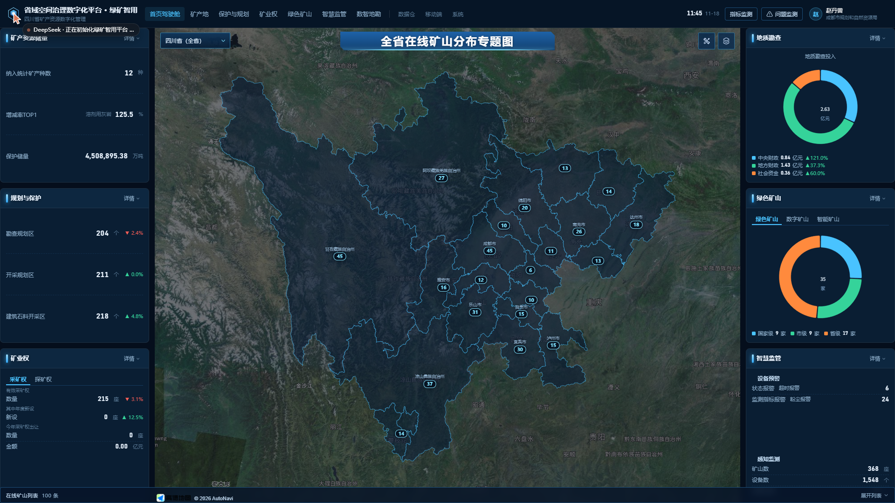 | 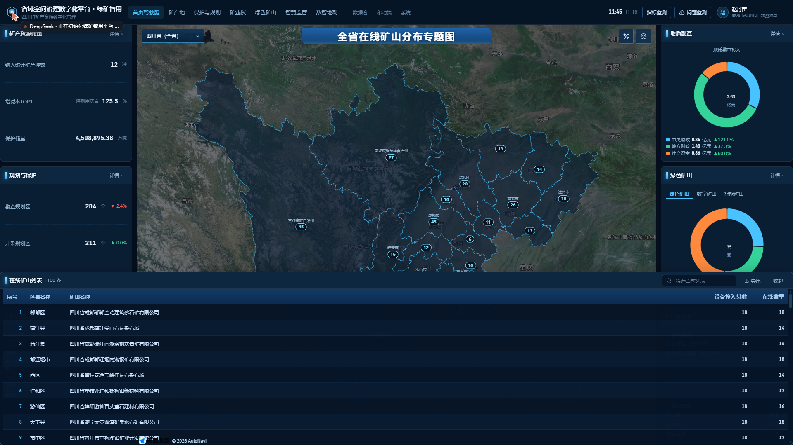 |

| 重点任务作战图 | 一矿一档 |
| --- | --- |
| 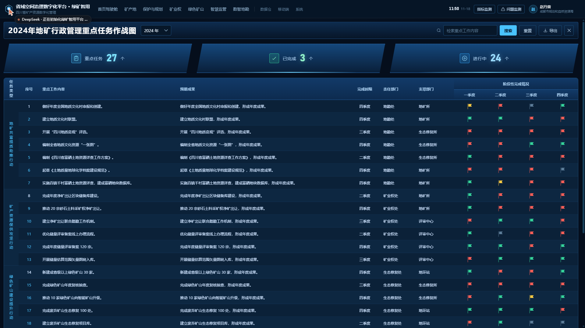 | 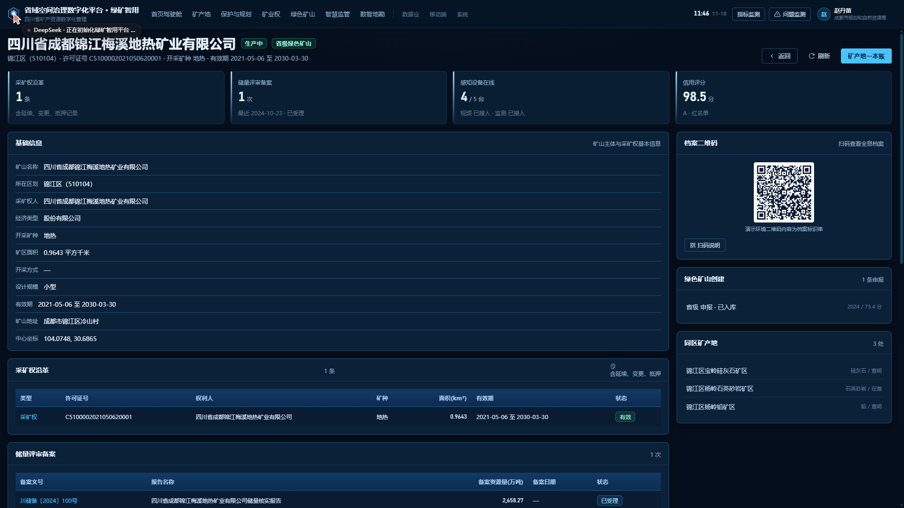 |

| 通用功能页（净矿出让） | 数据仓 |
| --- | --- |
| 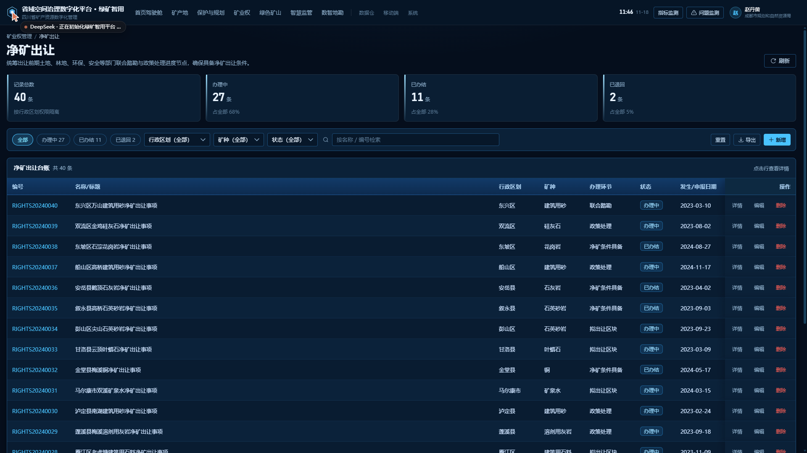 | 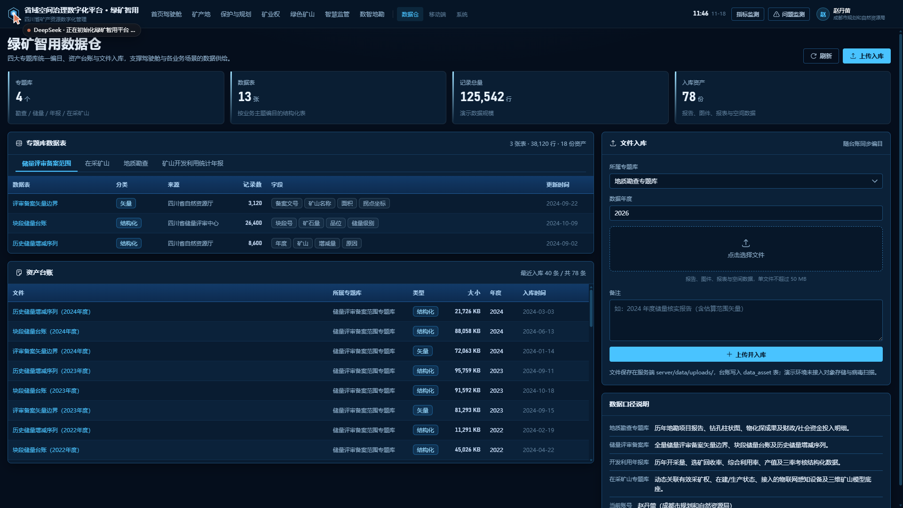 |

| 保护与规划（规划指标预警） | 绿色矿山专题 |
| --- | --- |
| 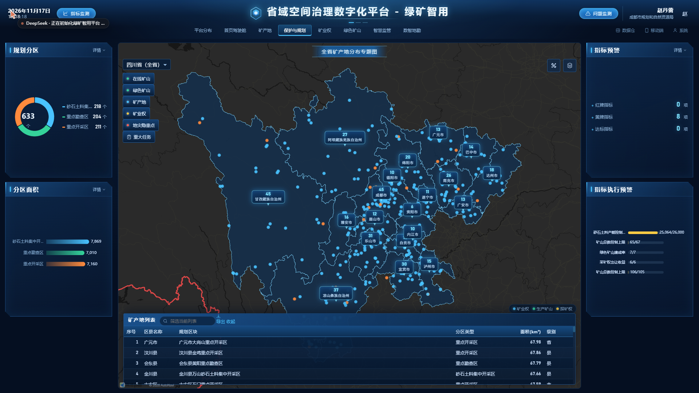 | 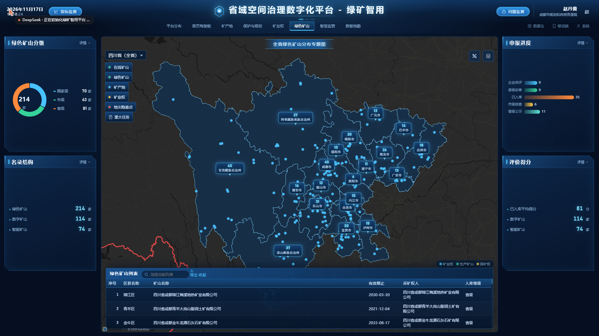 |

| 数据仓 | 政务移动端 | 系统管理 |
| --- | --- | --- |
| 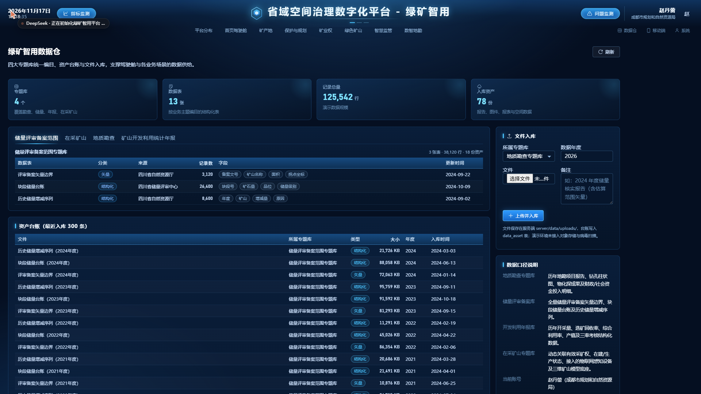 | 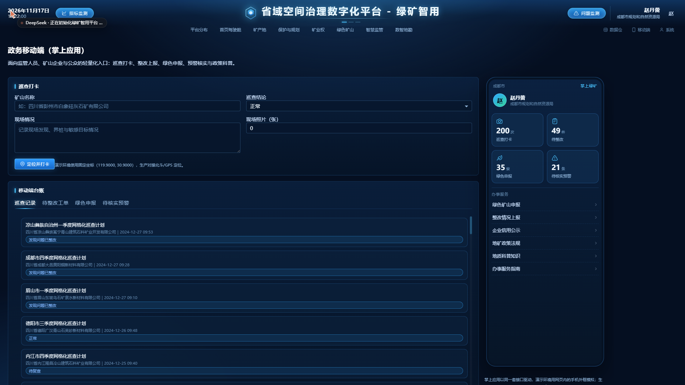 | 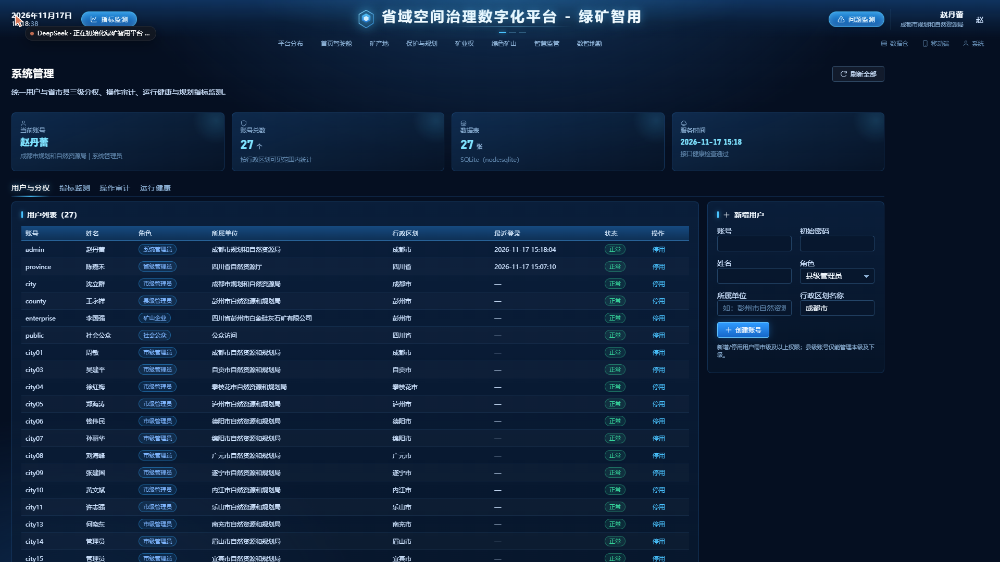 |

登录页：

### v2 演示版三项改造

| 改造 | 结论 | 详情 |
| --- | --- | --- |
| 图表统一 ECharts | 全站仅 ECharts（自绘 SVG/CSS 图表已全部移除），11 个界面逐项修复布局并留证 | [docs/07-三项改造说明.md](docs/07-三项改造说明.md#一图表统一为-echarts逐界面修复布局) |
| 接入高德地图 JS API | 底图、行政区划面、聚合气泡、矿山点位、测量、导出均已落地；Key 失效时自动降级为矢量底图 | [docs/07-三项改造说明.md](docs/07-三项改造说明.md#二高德地图-js-api-接入) |
| 浙江 → 四川全量替换 | 21 市州 / 183 区县、22 份边界、全量演示数据与文案替换，全站检索 0 命中浙江内容 | [docs/07-三项改造说明.md](docs/07-三项改造说明.md#三浙江--四川全量替换) |

---

## 七、验收对照

| 验收项 | 结论 | 证据 |
| --- | --- | --- |
| 功能设计文档每个功能点都有对应实现 | 通过：6 域 40 个功能点全部落地，逐条对照见 docs/03 | `server/src/features.js` + `/api/meta/bootstrap` 下发的规格即运行时事实源 |
| 可实际操作验证 | 通过：新增/编辑/删除/流程流转/导出/算法试算全链路已实测 | 见 docs/03 每行「验证方式」列 |
| 主要界面布局与截图基本一致 | 通过：驾驶舱三栏 + 顶部导航 + 底部浮动列表、作战图斜切统计卡与四色旗帜、门户双区矩阵 | docs/shots/*.png |
| 能按文档步骤启动 | 通过：`npm run setup → npm run seed → npm run dev`；或 `npm run build → npm start` | 见第三节 |

已知偏差（3 处，均因数据或截图口径差异，非功能缺失）：

1. 驾驶舱「绿色矿山列表」第 6 列截图为「入库时间」，数据库无该字段，改用**「有效期始」**呈现（口径更严谨）。
2. 地图为**矢量行政区划底图**（真实省界/市县界），截图为卫星影像底图；离线环境不接入商业影像服务，图层控制面板中已注明「基础参考图层待接底图」。
3. 矿山图斑为**按矿区面积折算的示意多边形**（真实矿权拐点坐标不公开），点击后属性卡字段与截图完全一致。

---

## 八、数据说明

- 行政区划：四川省 11 个地市 / 102 个区县，边界来自公开 GeoJSON，构建期抽稀至 340 KB。
- 业务数据：脚本按真实行业口径生成（矿种、勘查程度、许可证号规则、三率阈值、绿色矿山分级、预警分级），**全部为模拟数据**。
- 重置数据：`npm run seed` 幂等；强制重灌用 `node server/src/seed.js --force`。

---

## 九、许可与致谢

- 本项目代码：MIT。
- 动效组件来自 [react-bits](https://github.com/DavidHDev/react-bits)（MIT + Commons Clause），以源码拷贝方式引入，版权归原作者。
- 设计方法论参考 [taste-skill](https://github.com/Leonxlnx/taste-skill)（anti-slop 前端设计规范），落地为 [docs/05-设计规范.md](docs/05-设计规范.md)。
- 动画引擎：[GSAP](https://gsap.com/)（3.13 起标准插件免费）。
